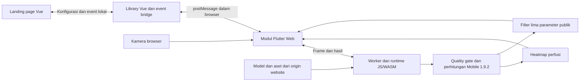

# Implementation plan — Seleris rPPG SDK untuk Vue

Tanggal: 8 September 2026  
Status: draft rencana; implementasi SDK belum dimulai.  
Referensi perilaku: Android/Flutter Mobile 1.9.2.  
Baseline teknis browser: Flutter Web 1.6.10, termasuk patch presentation contract.

SDK akan dikirim sebagai library siap integrasi yang menjalankan pengukuran sepenuhnya di browser. Website Vue mengurus halaman, profil pengguna, persetujuan kamera, dan penyajian lima hasil; SDK mengurus kamera, quality gate, inferensi, formula, serta heatmap. Tidak ada panggilan API pengukuran, LLM, atau upload gambar oleh SDK.

## 1. Keputusan arsitektur

Rilis pertama menggunakan **modul Flutter Web hasil build + runtime JS/WASM lokal**, dibungkus library npm `@seleris/rppg-vue`. Ini mengikuti urutan pada [macbook_dev.md](../macbook_dev.md): port dan buktikan parity Web dahulu, lalu sediakan integrasi Vue. Wrapper TypeScript hanya menangani lifecycle, konfigurasi, dan event; formula tidak ditulis ulang di wrapper.

Modul ditempatkan dalam iframe dari origin website yang sama, dikelola otomatis oleh komponen Vue. Iframe memberi pemisahan CSS dan global runtime dari landing page. Satu komponen scanner aktif per halaman menjadi kontrak rilis awal. Embed langsung melalui `hostElement` dapat dievaluasi kemudian jika diperlukan; bukan dua implementasi yang harus dipelihara dalam rilis pertama. Flutter mendokumentasikan kedua mekanisme embedding ini beserta perbedaannya. [Dokumentasi Flutter](https://docs.flutter.dev/platform-integration/web/embedding-flutter-web)

Alur data:



`postMessage` adalah komunikasi antarbagian aplikasi di browser, bukan HTTP API. Bridge menggunakan origin tujuan spesifik, pemeriksaan `event.origin`/`event.source`, versi protokol, `requestId`, `sessionId`, nomor urut, dan validasi payload. Event dari scan lama dibuang ketika retry, pergantian kamera, atau unmount.

### Bentuk distribusi

- Tarball npm privat, misalnya `seleris-rppg-vue-<versi>.tgz`, yang membawa komponen Vue terkompilasi, loader ESM, tipe TypeScript, dan direktori runtime hasil build.
- Helper build untuk menyalin direktori runtime secara utuh ke `public/vendor/seleris-rppg/<versi>/`. Developer tidak perlu memilih atau memindahkan file model satu per satu.
- ZIP handoff berisi tarball, example Vue, dokumentasi, manifest SHA-256, laporan parity, dan third-party notices.
- Source SDK tersimpan di folder pengembangan tersendiri. Distribusi konsumsi berisi hasil build; sourcemap pengembangan tidak dipublikasikan secara default.
- Developer Vue tidak perlu memasang Flutter, Kotlin, Android SDK, atau toolchain pembuat WASM untuk memakai paket.

Browser tidak memuat `.dll` Windows atau `.aar` Android secara langsung. Padanan yang sesuai adalah WebAssembly (`.wasm`) dengan loader JavaScript. Library hasil build memenuhi kebutuhan integrasi rapi, tetapi aset yang dikirim ke browser tetap dapat diunduh atau diperiksa; minification/WASM tidak menjamin kerahasiaan source atau model. ONNX Runtime Web mendukung inferensi di browser dan membutuhkan deployment file runtime/model yang sesuai. [ONNX Runtime Web](https://onnxruntime.ai/docs/tutorials/web/), [deployment](https://onnxruntime.ai/docs/tutorials/web/deploy.html)

## 2. Ruang lingkup output web

Interpretasi screenshot: lima kartu hasil menjadi daftar output publik. Tulisan promosi yang menyebut BMI atau “60+” tidak dipakai sebagai daftar fitur.

| Kartu web | Key publik yang diusulkan | Sumber dalam Care 1.9.2 | Unit |
|---|---|---|---|
| Heart Rate | `heartRate` | `domain_a_vital_signs.parameter.heart_rate` | bpm |
| Breath Rate | `breathingRate` | `domain_c_physio_hrv.parameter.laju_napas` | napas/menit |
| HRV | `hrv` | `domain_c_physio_hrv.parameter.hrv_sdnn` | ms |
| systole | `systolic` | `domain_a_vital_signs.parameter.tekanan_sistolik` | mmHg |
| Diastole | `diastolic` | `domain_a_vital_signs.parameter.tekanan_diastolik` | mmHg |

HRV sementara ditetapkan sebagai **SDNN**, mengikuti pemetaan `hrv` dalam runtime Mobile. Label screenshot tidak menjelaskan SDNN/RMSSD; keputusan ini perlu dikunci sebelum kontrak publik difinalkan. Metadata hasil akan menyatakan `method: sdnn`, sehingga HRV tidak ambigu. Asumsi contoh integrasi: Vue 3 + Vite; versi aktual landing page belum tersedia.

Aturan output:

1. Pertahankan perhitungan dan struktur Care internal; lakukan proyeksi lima parameter pada boundary publik SDK sebelum event diteruskan ke Vue.
2. Jangan meneruskan hasil Care lengkap melalui event generik, log publik, atau properti debug komponen. BMI, SpO2, usia, skor kesehatan, dan risiko penyakit tidak menjadi output paket web ini.
3. Setiap metric mempertahankan `value`, `unit`, `source`, `availability`, dan alasan tidak tersedia bila ada. Metadata SQI, progress, dan status scan merupakan data operasional, bukan tambahan vital signs.
4. Penanda estimasi dari Mobile tetap utuh. Sistolik/diastolik pada implementasi referensi adalah `formula_estimate`; kualitas sinyal yang lulus tidak mengubahnya menjadi pengukuran tekanan darah langsung.
5. Nilai sementara hanya diterbitkan bila baseline mengizinkan, dengan status provisional. Lima hasil akhir mengikuti snapshot final yang reliable. Jangan membuat angka dummy untuk mengisi kartu sebelum data tersedia.
6. Saat quality gate gagal, hasil akhir tidak diterbitkan. Output tidak tersedia ditampilkan sebagai kosong/`—`, bukan nol atau hasil scan sebelumnya.

Catatan implementasi penting: `SelerisCareInput` saat ini menolak selector kosong, termasuk `diseaseRisks: []`. Karena itu pembatasan output tidak boleh hanya mengandalkan mengosongkan selector. Kontrak internal yang valid dipertahankan, lalu bridge memproyeksikan hanya lima metric. Tidak perlu mengubah formula atau validator Mobile untuk kebutuhan presentasi Vue.

## 3. Input profil dan tanggung jawab host

Kontrak Care Mobile memerlukan `requestId`, usia, jenis kelamin, tinggi, berat, serta lifestyle. Formula tekanan darah memakai kategori HR/BMI, usia, merokok, alkohol, dan penggunaan sepeda motor. Ini perlu tersedia dari profil/form Vue sebelum scan lengkap dijalankan; angka profil tidak boleh ditebak dari kamera.

Rilis awal `0.1.0-dev.1` mempertahankan profil Care lengkap. Setelah pemeriksaan dependensi formula, pengguna menyetujui form minimal tujuh field pada 8 September dan pembaruan SDK pada 9 September 2026. Rilis **`0.1.0-dev.2`** kini menerima usia, jenis kelamin, tinggi, berat, merokok, alkohol, dan motor. [USER-PROFILE.md](docs/USER-PROFILE.md) menjadi acuan aktif. Validator, snapshot bridge, jalur perhitungan lima hasil, contoh Vue dan paket telah disesuaikan tanpa membuat jawaban pengganti untuk field yang dihapus. Kesetaraan nilai, pembulatan dan metadata diuji terhadap referensi Kotlin Mobile.

SDK tidak membaca profil dari endpoint. Host menyerahkan objek profil yang telah tersedia di browser. Lifecycle kamera tetap dimulai melalui tindakan pengguna. Akses kamera memerlukan HTTPS atau localhost, dan iframe perlu delegasi izin kamera yang tepat. [MDN getUserMedia](https://developer.mozilla.org/en-US/docs/Web/API/MediaDevices/getUserMedia)

## 4. Perilaku yang harus mengikuti Mobile 1.9.2

| Area | Target implementasi dan verifikasi |
|---|---|
| Face gate | Wajah valid, posisi/ukuran/pose, multiple faces, timeout, serta pemulihan mengikuti source Mobile. Perbedaan detector Android dan browser diukur dengan fixture/perangkat. |
| Cahaya | Port statistik luminance, ambang gelap/terlalu terang/backlight, dan hysteresis dari `CameraLightingGate.kt`; jangan sekadar memakai brightness global. |
| Kacamata/aksesori | Gunakan model FaceAttribNet yang dipin, preprocessing/tensor/index/threshold/cadence/hysteresis resmi. Kacamata, sunglasses, dan masker menghalangi admission sesuai Mobile. Model gagal dimuat tidak dianggap lolos. |
| Preflight SQI | Profil v2; window 3 detik, minimal 54 accepted samples, accepted rate minimal 18 Hz, SQI minimal 0,20; aturan spectral borderline dan analyzer admission 24 Hz mengikuti Mobile. |
| Measurement | 900 accepted samples; progress dihitung dari sampel diterima. Frame ditolak tidak menaikkan progress dan tidak digandakan untuk mengejar FPS. |
| SQI final | Ambang minimal 0,40 dan evaluasi window mengikuti source; angka threshold sama saja belum membuktikan parity. |
| Motion | Sudden 8%, gradual anchor 17%, pose/lip activity, rejected ratio 35%, accepted-sample gap 2 detik, dan measurement timeout 45 detik sesuai detail boundary Mobile. |
| Spoof screening | Screening fisiologis pasif pada sekitar 300/500 accepted samples, termasuk evidence dan error asli. Tidak ada challenge kedip/angguk, `scanRequiresOpenEyes=false`; jangan menyatakan PAD bersertifikasi. |
| Kamera/lifecycle | Kamera depan default, dukungan belakang berdasarkan kemampuan perangkat, mirror sesuai facing. Stop stream, worker, timer, dan output pada unmount/interupsi. Browser tidak menyediakan semua telemetry CameraX; field tidak didukung dinyatakan eksplisit. |
| Formula dan hasil | Gunakan formula resmi termasuk `bp-fallback-v1.6.10`. Internal Care, rounding usia 1.9.2, kategori, serta provenance diuji walaupun output publik hanya lima metric. |
| Still frame opsional | Pertahankan semantics 1.9.1/1.9.2: request setelah minimal 15 accepted samples dan wajah valid, request token, watchdog 1,5 detik, maksimal tiga attempt, final ready/failed sebelum result untuk scan reliable. Kegagalan foto tidak menggagalkan vital signs. |
| Wording lokal | Gunakan katalog/fallback lokal. Jalur LLM/API dinonaktifkan untuk produk ini, konsisten dengan kebutuhan tanpa API dan binary referensi yang fallback-only. |

Durasi “30 detik” adalah perkiraan 900 sampel pada 30 Hz. Persiapan, preflight, dan frame yang ditolak dapat menambah durasi; batas 45 detik berlaku pada fase measurement. SDK tidak memaksa selesai tepat 30 detik dengan melonggarkan gate. Jika perangkat tidak memenuhi cadence, hasilnya error yang dapat ditindaklanjuti.

## 5. Heatmap: port yang diperlukan

Audit source menemukan perbedaan nyata:

- Web 1.6.10: `drawHeatmap()` memakai grid 12×12 dengan intensitas dari selisih kanal hijau dan merah pada frame saat itu.
- Mobile: `PerfusionHeatmapView` menampilkan `LivePerfusionMap` 18×18, dengan filter, warna, clipping kontur, dan attenuation mata/mulut. Core portable tersedia pada `native/src/perfusion_visualizer.cpp`.

Karena targetnya perilaku Mobile, heatmap Web yang sekarang belum memenuhi acceptance. Tahap implementasi:

1. Trace pembentukan grid perfusi Mobile dari core sampai renderer, termasuk timestamp, readiness, normalisasi, dan smoothing.
2. Prioritaskan kompilasi bagian portable C++ yang diperlukan ke WASM dan panggil melalui worker. Bila dependensi build memerlukan adaptasi browser, implementasi harus dibandingkan terhadap golden output C++ sebelum dipakai.
3. Port filter/colormap dan transform ROI ke overlay browser; cocokkan grid 18×18, kontur/fallback geometry, crop, resize, serta mirror depan/belakang.
4. Tampilkan heatmap hanya pada state yang diizinkan Mobile. Clear saat invalid, cancel, retry, atau terminal failure. Jangan menghidupkan overlay hanya karena wajah terdeteksi.
5. Sediakan toggle dan ekspor heatmap sebagai `Blob` PNG lokal. Default ekspor berupa overlay tanpa foto wajah; komposit dengan frame memerlukan opsi eksplisit. Still frame dan heatmap adalah keluaran berbeda.
6. Verifikasi intensitas sebelum rendering secara numerik; verifikasi gambar dengan toleransi rasterisasi yang didokumentasikan. Screenshot mirip saja tidak cukup.

Jaring wajah hijau dalam screenshot adalah face mesh, bukan heatmap perfusi. Rilis awal menjamin indikator wajah/ROI dan heatmap sesuai Mobile. Replikasi mesh dekoratif persis tidak menjadi syarat parity; penambahan model landmark hanya untuk menyamai tampilan harus dievaluasi terpisah terhadap anggaran FPS.

## 6. API integrasi yang diusulkan

Nama berikut adalah rancangan, belum API yang tersedia.

| Elemen | Kontrak awal |
|---|---|
| Komponen | `SelerisScanner`, menyediakan area kamera/overlay yang dapat ditempatkan pada kolom tengah layout Vue |
| Konfigurasi | `assetBaseUrl`, `profile`, `language`, `cameraFacing`, `heatmapEnabled`, `captureStillFrame` |
| Method | `initialize()`, `start()`, `cancel()`, `retry()`, `setCameraFacing()`, `setHeatmapEnabled()`, `exportHeatmap()`, `dispose()` |
| Event operasional | `ready`, `state`, `progress`, `quality`, `error`, `heatmapStatus`, `stillFrameReady`, `stillFrameFailed` |
| Event angka | `liveVitals` hanya untuk nilai provisional yang diizinkan; `result` untuk lima hasil final dan metadata |
| Error | Kode stabil dari runtime, stage, retryability, dan pesan lokal; kode tambahan bridge diberi namespace tersendiri |
| Capabilities | Versi paket, versi kontrak bridge, versi referensi Mobile, status parity, dukungan kamera/heatmap/still frame, dan batas kemampuan browser |

Vue menampilkan kartu kanan dari event `result`; progress/SQI/status cahaya/kacamata berasal dari event operasional. Wrapper tidak menghitung ulang HRV, tekanan darah, kategori, atau SQI. UI dapat menyesuaikan label dan layout tanpa membuka implementasi algoritma.

## 7. Kontrak tanpa API dan deployment

- Model, WASM, JS, worker, katalog, dan aset renderer Flutter disajikan dari origin website sendiri. Tidak ada dependency CDN runtime atau font jarak jauh.
- Website masih mengunduh berkas statis pada pemuatan awal. “Tanpa API” berarti tidak ada request layanan pengukuran atau pengiriman data scan; bukan berarti halaman bisa dimuat pertama kali tanpa berkas lokal/cache.
- Sesudah `ready` memastikan seluruh aset yang dibutuhkan telah dimuat, scan diuji dengan akses jaringan diputus. Cold reload sepenuhnya offline memerlukan caching tambahan yang bukan asumsi otomatis dari library; PWA cache dapat ditambahkan sebagai opsi terpisah.
- Dokumentasikan HTTPS, `Permissions-Policy`, izin iframe kamera, CSP script/worker/WASM, MIME `.wasm`, base path subdirektori, cache versi, dan penanganan 404 agar tidak tertelan SPA fallback.
- Pertahankan fallback satu thread tanpa COOP/COEP jika sesuai baseline. Multithread hanya diaktifkan bila lingkungan browser mendukung dan lolos gate. Konfigurasi header diuji bersama landing page.
- Gagal memuat model atau WASM menghasilkan initialization error; tidak beralih diam-diam ke inferensi server.
- Request jaringan SDK diamati dalam pengujian browser, termasuk worker/iframe. Kriteria: aset same-origin saat inisialisasi; nol endpoint inferensi/LLM/telemetry/upload selama scan.
- Ukuran awal aset Web yang ditemukan sekitar 69 MiB di disk, termasuk sekitar 48 MiB runtime. Ukuran paket, transfer terkompresi, cold start, dan peak memory diukur setelah build; angka ini bukan ukuran download final.

## 8. Struktur folder pengembangan dan deliverable

```text
seleris-rppg-vue-sdk/
  IMPLEMENTATION_PLAN.md          # dokumen saat ini
  INITIAL_AUDIT.md                # temuan pemeriksaan awal
  packages/
    rppg-vue/                    # adapter Vue, loader, types; tanpa formula
  engine/
    flutter-web/                 # salinan kerja port Web, terpisah dari baseline
    wasm/                        # binding/build bagian portable yang diperlukan
  examples/
    vue-vite/                    # form profil, preview, 5 kartu, SQI, export
  tests/
    golden/                      # input identik dan hasil referensi Mobile/core
    browser/                     # lifecycle, kamera, performa, dan network
    contract/                    # boundary 5 metric dan bridge
  scripts/                       # build, copy-assets, audit, release untuk macOS
  docs/
    QUICKSTART-VUE.md
    INTEGRATION-GUIDE.md
    API-REFERENCE.md
    INPUT-OUTPUT-CONTRACT.md
    QUALITY-GATES.md
    HEATMAP-GUIDE.md
    DEPLOYMENT.md
    TROUBLESHOOTING.md
    PARITY-MATRIX.md
    RELEASE-VERIFICATION.md
  dist/                          # tgz, ZIP handoff, manifest hash
```

Hanya dua dokumen rencana/audit dibuat pada tahap ini. Struktur lain adalah target implementasi. Source/binary Android, iOS, Web baseline, dan `dist` lama tetap menjadi referensi.

## 9. Tahapan implementasi dan hasil yang harus tersedia

| Tahap | Pekerjaan | Deliverable / syarat selesai |
|---|---|---|
| 0 — Kesiapan baseline | Selesaikan audit transfer, path native runtime, dependency npm, manifest `_baselines`, dan toolchain. Siapkan Git lokal/.gitignore, baseline commit `macbook-handoff-clean-1.9.2`, branch Web/Vue, serta jejak pengembangan sesuai handoff sebelum edit source. | Baseline dapat dibangun/dites, atau setiap hambatan environment terdokumentasi secara spesifik. Hash acuan dibekukan. |
| 1 — Kontrak dan golden | Kunci HRV dan host Vue; inventaris gap 1.6.10 → 1.9.2; trace input/output lima metric, queue/cadence, lighting/accessory, SQI, perfusion, still frame. Buat runner referensi dan fixture lintas platform. | Kontrak typed, daftar gap dengan source owner, toleransi numerik per tahap yang ditetapkan sebelum implementasi. |
| 2 — Port perilaku Web | Port perubahan scan, kamera, cadence/admission, HR provisional, spoof screening, still frame, telemetry, Care/age serialization. Pertahankan model dan formula resmi; nonaktifkan jalur network produk. | Golden numerik, boundary quality gate, event ordering, failure, dan internal schema lulus. |
| 3 — Heatmap | Bawa core/filter perfusi Mobile ke browser, overlay dan export; ukur dampak pada cadence. | Golden grid/warna/readiness serta pengujian transform/export lulus. |
| 4 — Packaging Vue | Build modul scanner, bridge, komponen, helper copy-assets, example lima kartu, dan tarball konsumsi. | Pasang tarball pada project Vue bersih, cukup konfigurasi aset/profil dan mount komponen; build host tanpa Flutter. |
| 5 — Validasi dan handoff | Jalankan matriks browser/perangkat, network isolation, repeated scans, release QA, dan latihan integrasi memakai guide. | Dokumentasi lengkap, laporan hasil aktual, `.tgz` + ZIP + SHA-256 + notices; release hanya untuk cakupan yang sudah terbukti. |

Urutan inti: 0 → 1 → 2 → 3 → 4 → 5. Kerangka kontrak, dokumentasi, dan analisis gap dapat disiapkan saat hambatan environment diselesaikan, tetapi status parity tidak boleh dinyatakan lulus sebelum bukti tersedia.

Estimasi awal untuk satu developer: sekitar **3–5 minggu kerja setelah toolchain/dependency siap**, dengan risiko terbesar pada parity perfusi, preprocessing/detector browser, dan cadence perangkat. Estimasi dikalibrasi ulang setelah tahap 1; tidak mencakup validasi klinis atau perombakan landing page.

## 10. Strategi pengujian dan acceptance rilis

1. **Referensi Android:** jalankan format check, analyzer, Flutter tests, native unit tests, AAR dan example APK build sesuai `macbook_dev.md`. Laporan bawaan menyebut 42 Flutter dan 83 native tests; hasil itu belum dianggap hasil eksekusi di Mac ini.
2. **Replay deterministik:** berikan input frame/ROI/BVP, timestamp, state model, dan profil identik ke referensi dan Web. Bandingkan preprocessing, inferensi, HR, RR, SDNN, tekanan darah, SQI, perfusi, serta kategori/source/availability. Pisahkan toleransi floating point dari keputusan gate yang harus sama. Jangan memperlebar toleransi/threshold agar test lulus.
3. **State machine:** cahaya kurang/backlight/overexposure, kacamata/masker, multiple faces, gerak/lip activity, cadence rendah, spoof evidence, tab background, kamera terputus, cancel/retry, dan still-frame timeout/late callback. Pastikan urutan event dan clearing hasil sama.
4. **Output terbatas:** setiap event publik/result hanya mengandung metric dalam allowlist lima key. Result tidak membawa domain/skor/risiko tersembunyi atau angka dari attempt sebelumnya. Provenance estimasi dan null tidak hilang saat serialisasi.
5. **Browser nyata:** target awal Chrome/Edge desktop, kemudian Safari macOS, Chrome Android, dan Safari iOS. Catat versi browser/device aktual. Lulus di desktop tidak otomatis berarti mobile lulus; kegagalan cadence dicatat, tidak diperbaiki dengan melonggarkan gate.
6. **Packaging/deployment:** install tarball pada Vue 3 + Vite yang bersih; uji root/subpath, cache upgrade, route unmount/remount, izin ditolak, worker/model 404, CSP, satu thread, dan opsi multithread bila tersedia. Nuxt diuji bila itu stack host yang dipilih.
7. **Performa:** ukur accepted/analyzer FPS, latency p50/p95, cold/warm initialization, dropped/rejected frames, memory, serta pengaruh toggle heatmap. Inference tidak menahan UI; antrean bounded dan timestamp tidak dipalsukan.
8. **Tanpa API:** load seluruh aset lokal, putus jaringan, lalu scan; pastikan tidak ada upload frame/hasil, endpoint LLM, telemetry jarak jauh, atau fallback server dari SDK.
9. **Dokumentasi dapat dipakai:** lakukan integrasi ulang hanya dari ZIP dan guide. Developer host tidak mengedit algoritma, worker, WASM, atau path model individual.

Selama belum lulus, gunakan versi development seperti `0.1.0-dev`, `referenceMobileVersion: 1.9.2`, dan `parityCertified: false`. Versi referensi bukan sertifikat parity. Identitas rilis yang mengklaim setara 1.9.2 hanya diterbitkan setelah numeric, behavioral, browser/device, dan packaging gates selesai; batas dukungan dicantumkan.

## 11. Temuan awal yang memengaruhi urutan kerja

Pemeriksaan read-only menghasilkan 28/28 checksum `dist`, 2/2 checksum patch presentation 1.6.10, 36/36 hash algorithm parity Mobile, dan 10/10 hash aset Web yang dipin cocok. Manifest Windows perlu dibaca dengan penanganan CRLF; manifest asli tidak diubah.

Hambatan environment: `_baselines` dan `working/web-sdk-npm` tidak ditemukan; native runtime berada di root sehingga ada path build relatif yang salah; Flutter/Dart/Node/npm/adb belum ditemukan di PATH sesi ini, Java runtime tidak tersedia melalui launcher sistem, dan Xcode penuh belum aktif. Root belum merupakan repository Git. Rincian dan batas pemeriksaan ada di [INITIAL_AUDIT.md](INITIAL_AUDIT.md).

Temuan tersebut tidak menghalangi penyusunan plan. Porting, pengujian executable, dan klaim parity memerlukan penyelesaian dependency/path atau dokumentasi hambatan yang jelas. Jika audit lanjutan menemukan konflik dokumentasi versus source, bagian terkait ditahan dan bukti dicatat sebelum meminta keputusan; bagian yang tidak terdampak tetap dapat dikerjakan.

## 12. Referensi lokal utama

- [Instruksi handoff MacBook](../macbook_dev.md).
- [Mobile README 1.9.2](../seleris-rppg-flutter-profile-a-1.9.2/README.md), [changelog](../seleris-rppg-flutter-profile-a-1.9.2/CHANGELOG.md), [handoff manifest](../seleris-rppg-flutter-profile-a-1.9.2/HANDOFF_MANIFEST.md).
- [Implementasi Mobile 1.9.2](../seleris-rppg-flutter-profile-a-1.9.2/docs/IMPLEMENTASI-ANDROID-FLUTTER-1.9.2.md), [release verification](../seleris-rppg-flutter-profile-a-1.9.2/docs/RELEASE-VERIFICATION-1.9.2.md), [schema](../seleris-rppg-flutter-profile-a-1.9.2/docs/schema/care-v3-1.9.2.schema.json).
- [Kontrak input/hasil Dart](../seleris-rppg-flutter-profile-a-1.9.2/lib/src/care_result.dart).
- [Web README](../seleris-rppg-flutter-profile-a-web-1.6.10/README.md), [handoff manifest patch](../seleris-rppg-flutter-profile-a-web-1.6.10/HANDOFF_MANIFEST.md), [runtime Web](../seleris-rppg-flutter-profile-a-web-1.6.10/assets/web/seleris_rppg_runtime.js).
- [Formula Mobile](../native-runtime-1.9.2/app/src/main/kotlin/ai/seleris/merppg/demo/VitalInsightsModels.kt), [Care runtime](../native-runtime-1.9.2/rppg-runtime/src/main/kotlin/ai/seleris/rppg/profilea/CareRuntimeModels.kt).
- [Renderer heatmap Mobile](../native-runtime-1.9.2/rppg-runtime/src/main/kotlin/ai/seleris/rppg/profilea/PerfusionHeatmapView.kt), [core perfusi portable](../seleris-merppg-sdk-hardened-0.8.0/native/src/perfusion_visualizer.cpp).
