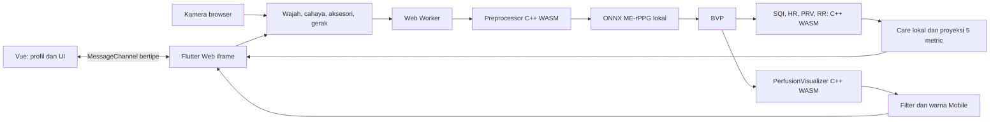

# Arsitektur SDK

Tidak ada server inference atau perhitungan pada Vue. Library Vue mengelola lifecycle, profil, event bridge dan komponen. Flutter menyediakan modul embed terkompilasi; transport kamera/model browser berada di dalam modul itu. DLL bukan format browser; binary algoritma berupa WebAssembly.

## Referensi Mobile 1.9.2

- Sumber native core berasal dari ME-rPPG 0.8.0 yang digunakan Mobile 1.9.2. `engine/native-core/SOURCE_SHA256.json` memverifikasi source sebelum build. Port tidak mengubah kernel.
- Deterministic preprocessing menggunakan kernel C++ yang sama. Crop mengikuti pembulatan ties-to-even; smoothing/ekspansi ROI lama Web dinonaktifkan.
- Model ONNX dan recurrent state tetap dipin. Preflight memiliki state sendiri yang dibuang sebelum pengukuran 900 sampel.
- Final HR/SQI/PRV/RR/morphology menggunakan core WASM; estimasi provisional mengikuti monitor Mobile. Hasil live disembunyikan ketika gate tidak valid.
- SQI final minimum 0,40. Preflight 3 detik, minimum 54 sampel/18 Hz, SQI 0,20; band 0,20–0,35 membutuhkan spectral peak ratio minimal 3. Pemeriksaan cadence analyzer 24 Hz terpisah. Rolling window mulai 0/200/400/600 dengan panjang 300.
- Cahaya memiliki status checking/ready/too_dark/backlight. Mobile tidak memiliki gate overexposure terpisah; tidak ditambahkan gate baru.
- Model aksesori memakai threshold 0,60, konfirmasi 3, clear 5 pada skor <=0,35; cadence 200 ms. Kacamata, sunglasses dan masker menahan admission.
- Spoof screening mengikuti bukti SQI/spectral Mobile; tidak menambahkan blink/nod/open-eyes challenge.

## Heatmap

Produksi grid memakai `PerfusionVisualizer` asli: **18×18**, BVP-coupled, warmup **90** accepted frames, update stride **3**, minimum confidence **0,10**. Filter display memakai smoothing spasial [1,2,1], stretch P15/P85 dengan minimum span 8, smoothstep dan 8 warna Mobile. Opacity maksimal **0,66**; nilai kecil transparan. Golden Kotlin membandingkan semua 256 RGBA dan 16 grid lengkap.

Web memakai fallback geometri resmi Mobile ketika contour detail tidak tersedia: oval wajah dengan perluasan dahi 12%, sisi 3%, bawah 2%, serta feathering area mata/mulut. Detector browser baseline BlazeFace menyediakan enam landmark, sedangkan Android menggunakan ML Kit dengan contour yang lebih rinci. Karena itu pixel overlay/face detection lintas kamera belum dapat diklaim identik. Filter/grid/warna tidak diganti dengan warna dekoratif berbasis RGB sesaat.

Output heatmap PNG mengikuti orientasi preview aktual. Snapshot final dipertahankan di memori sampai scan baru/dispose. Heatmap tidak memiliki unit klinis; intensitas bersifat relatif.

## Kontrak hasil dan privasi

Profil tujuh field dikonversi ke input internal `seleris.web.vitals.input.v1`. Library hanya menyalin empat data dasar dan tiga boolean lifestyle; field tambahan tidak diteruskan. Jalur runtime ini memakai formula Mobile yang sama hingga menghasilkan HR, RR, SDNN, SBP dan DBP, lalu berhenti sebelum perhitungan metric/risk/score Care lainnya. Tidak ada jawaban lifestyle buatan atau default untuk pertanyaan yang dihapus.

Vue menerima lima parameter dan quality saja; BVP, morphology, risk/score dan metric lain tidak diteruskan. Formula tidak dihitung ulang oleh wrapper. Pembulatan, `source`, `availability`, confidence dan metode SDNN dipertahankan. Unit publik ditetapkan pada kontrak lima metric agar placeholder `unit` dari template Care lama tidak muncul di UI. Jalur Care lengkap tetap ada sebagai baseline internal dan pembanding pengujian; bukan keluaran profil minimal.

Video/RGB hanya berada dalam memori, frame RGB inference ditransfer ke worker dan buffer dibersihkan setelah dipakai. Kamera berhenti pada cancel, error, result, tab background, route unmount dan dispose. Foto opt-in dan export dikembalikan sebagai Blob lokal. Host bertanggung jawab atas tindakan lanjutan yang dibuatnya sendiri; SDK tidak mengirim hasil.

MessageChannel diawali validasi origin/source/embed ID, kemudian command ID/session ID/sequence melindungi lifecycle dari callback lama. Tetap same-origin dengan host; isolasi ini bukan pertahanan terhadap skrip berbahaya yang sudah berjalan di origin website sendiri.

## Batas parity

Parity angka kernel dan fixture formula tidak membuktikan akurasi klinis atau seluruh perilaku perangkat. Kamera browser tidak memberikan semua metadata CameraX dan Y-plane Android. RGB canvas, exposure, deteksi contour, transform GPU/canvas, serta FPS nyata harus diuji pada perangkat sasaran. Full Care 50 metric tidak menjadi kontrak publik paket ini; bukti numerik formula pada rilis ini berfokus pada lima parameter yang diminta.
